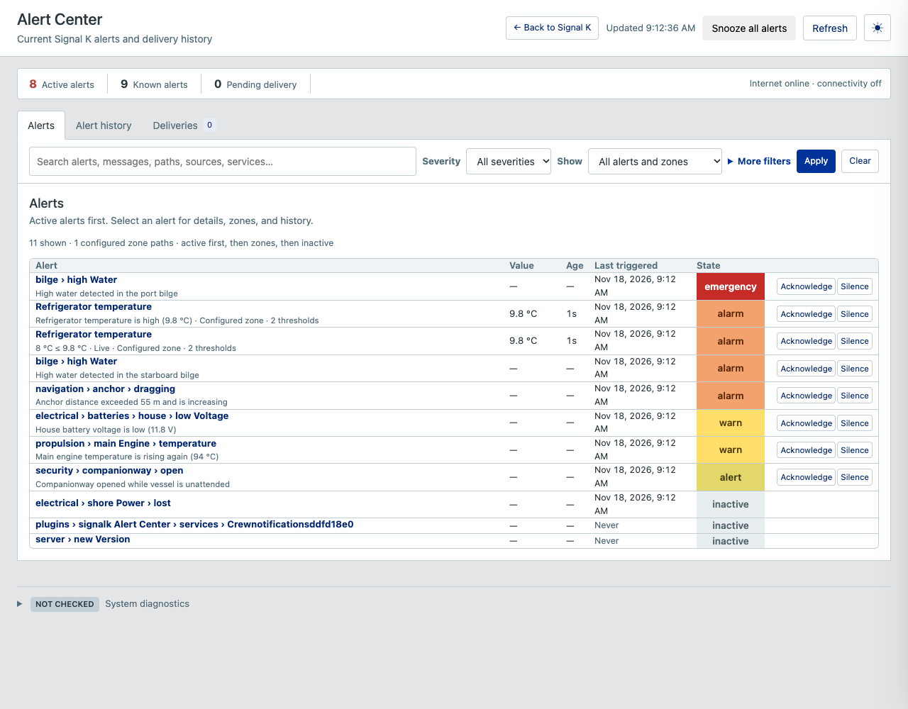
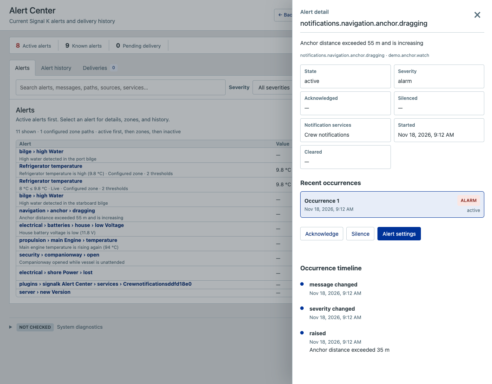
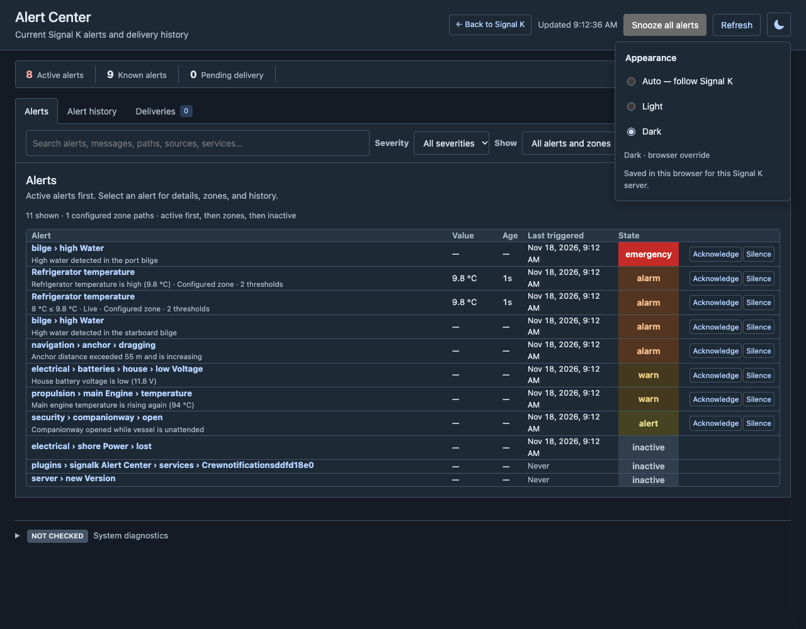
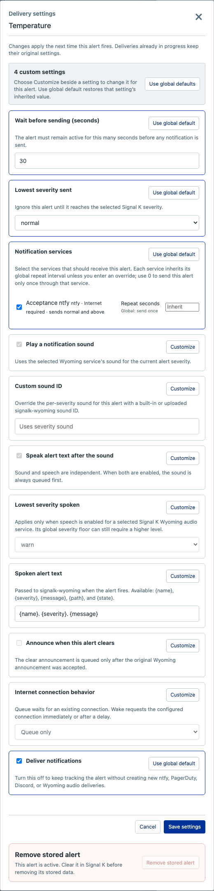
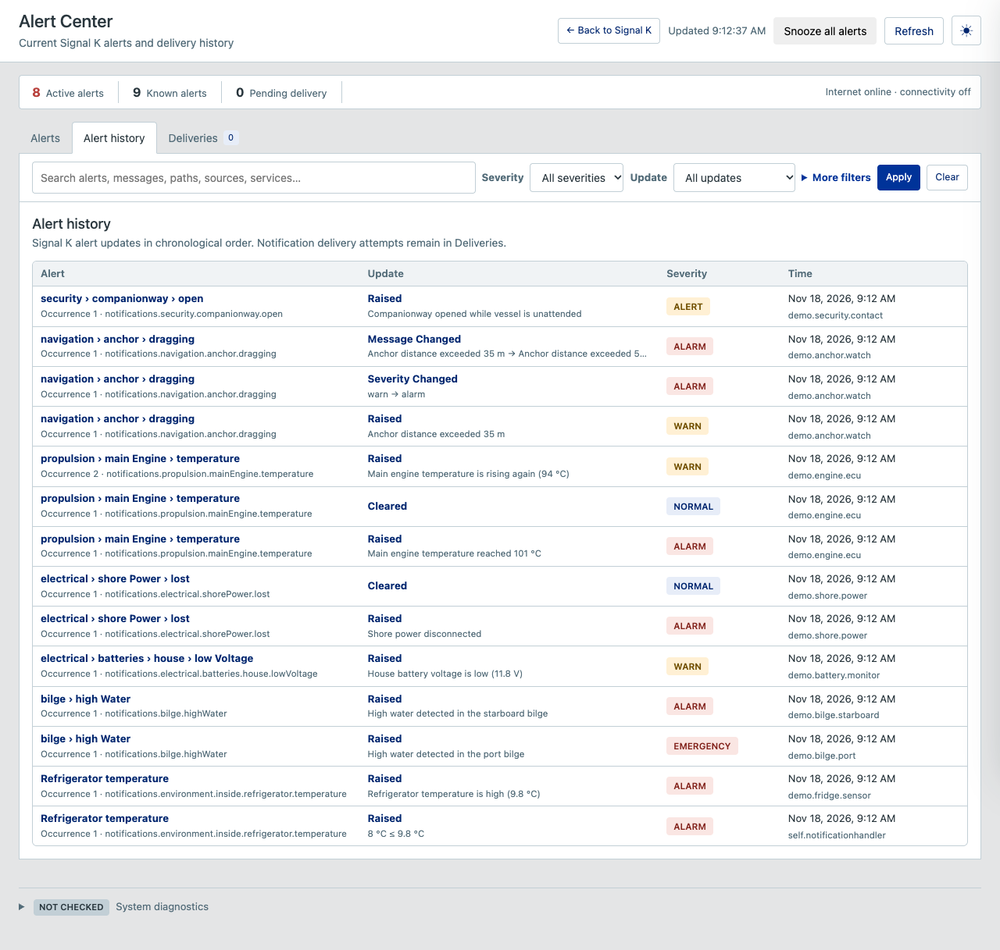
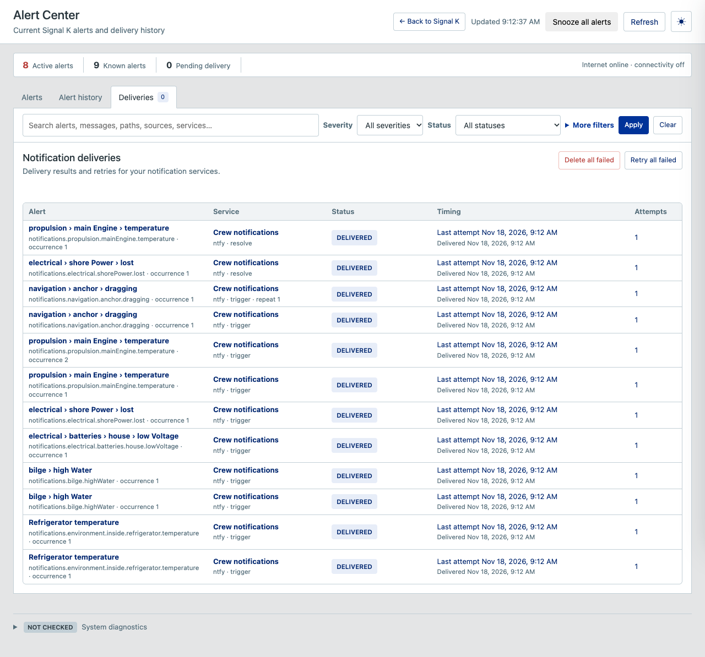
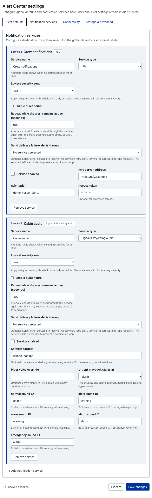
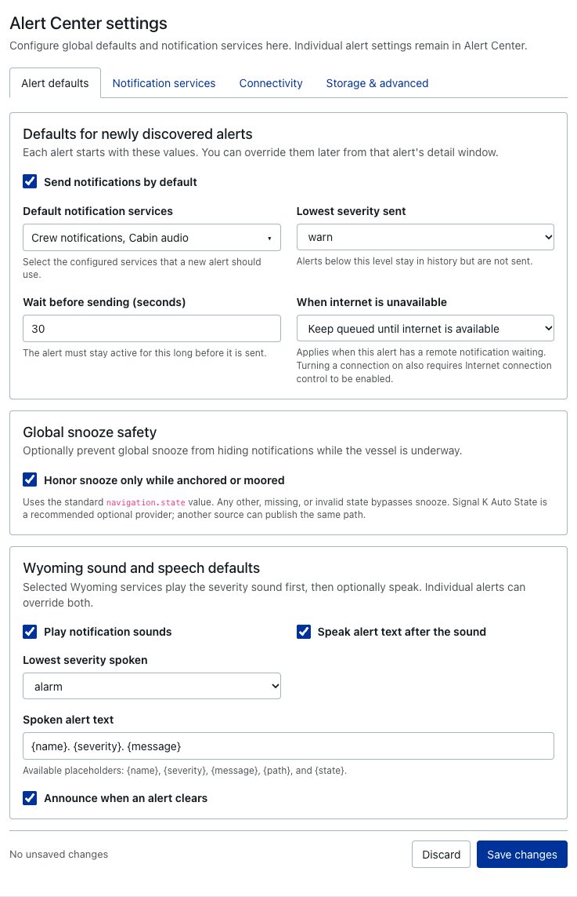
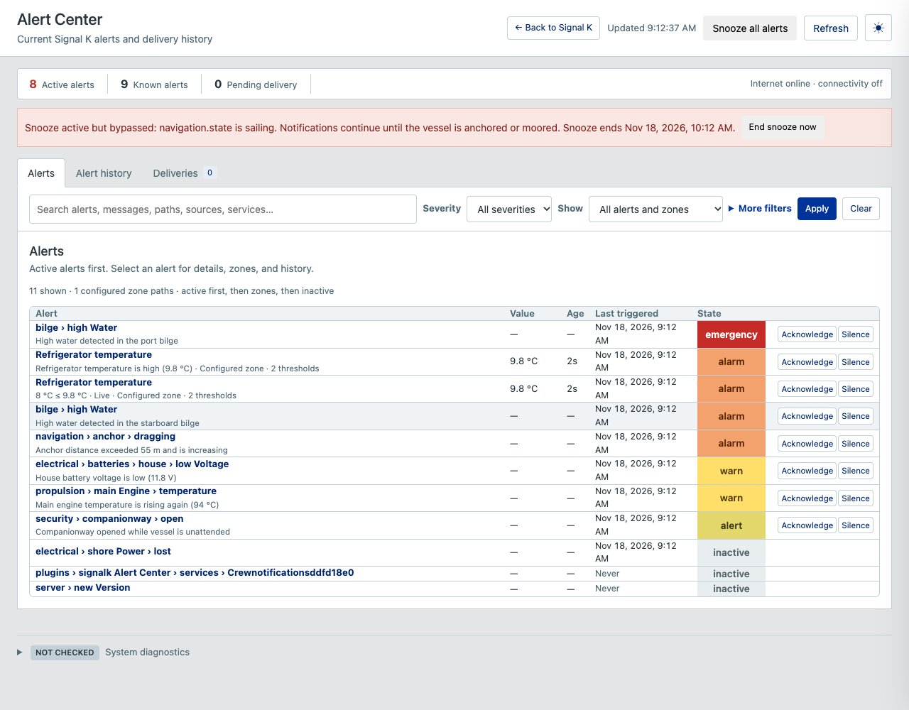
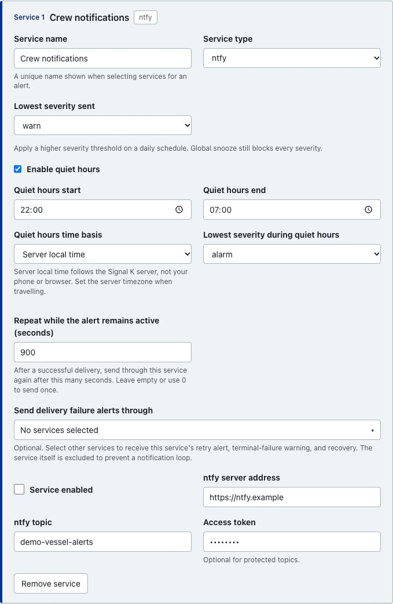

# Signal K Alert Center

One place for your boat's alerts, history, and notification delivery. See live
readings and configured Signal K zones, keep history across restarts, and queue
notifications while offline for delivery when connectivity returns.

## Supported notification services

| Service                                                     | Use it for                                                                        |
| ----------------------------------------------------------- | --------------------------------------------------------------------------------- |
|  **ntfy**                | Push notifications through your own ntfy server or a hosted service.              |
|  **PagerDuty** | Incidents with trigger, acknowledgement, and resolution events.                   |
|  **Discord**       | Alert and recovery messages through webhooks.                                     |
|  **Telegram**    | Bot messages to chats and forum topics, with optional silent delivery.            |
| **Pushover**                                                | Push notifications to users or groups, with optional devices and sounds.          |
| **Signal K Wyoming**                                        | Onboard notification sounds and spoken alerts through optional `signalk-wyoming`. |

Use several services together, with independent delivery tracking and retries.
**No audio plugin is required.** Wyoming audio needs `signalk-wyoming` 0.3.0 or
newer; speech also needs a TTS service such as `signalk-piper`. You can use the
alert list and history without configuring any notification service.

[Get started](#installation-and-first-run) ·
[Service setup](#notification-service-settings) ·
[Snooze](#snooze-all-alerts) ·
[Quiet hours](#quiet-hours-per-notification-service)



## Why use it?

Signal K normally exposes the current notification state. Alert Center adds the
operational history and delivery tracking needed when alerts matter after the
current value changes:

- **See what needs attention now.** Active alerts appear first in one compact
  list, followed by configured zones with no active alert (shown as Normal),
  then inactive discovered alerts. All definitions are loaded without a
  history-based “Load more” button, and **Last triggered** shows the start of
  each alert's most recent occurrence. Choose **Zones and active alerts** to
  hide inactive discovered alerts. Normal means no active alert has been
  reported; it does not certify sensor availability or freshness.
- **Keep the full story.** Raises, meaningful updates, clears,
  acknowledgements, silences, and delivery results remain available after a
  restart.
- **Configure each alert.** Choose its notification services, minimum severity,
  activation delay, connectivity behavior, and per-service repeat interval.
- **Deliver through unreliable connectivity.** Outbound work is stored before
  sending. Each service retries independently, so one failure does not resend a
  notification that another service already accepted.
- **Use the services that fit your boat.** Alert Center supports ntfy,
  PagerDuty, Discord, Telegram, Pushover, and optional Signal K Wyoming sounds and spoken
  announcements.
- **Understand every delivery.** The delivery view shows the destination,
  status, timing, retry attempts, and error details.
- **Choose when to be notified.** Snooze all services temporarily, or set quiet
  hours and a severity threshold for each service using server-local time or a
  specific timezone.
- **See service failures as Signal K notifications.** Each enabled notification
  service publishes its own health notification: `normal` when no delivery
  failure remains, `alert` while failed deliveries await retry, and `warn` when
  a delivery has failed permanently. Each service can send these health alerts
  and their recovery through selected backup services.

## Alert Center

Open **Webapps → Signal K Alert Center** after enabling the plugin.

The main table combines all known alert definitions:

- Signal K core alerts and legacy `notifications.*` paths;
- Alert Rules definitions, including rules that have never fired;
- paths defined by Signal K `meta.zones`, even before they fire;
- the current state and severity, with active alerts first.

Select an alert to see its latest occurrence, the five most recent occurrences,
and its event history. **Acknowledge** and **Silence** use Signal K's core alerts
or notification API when the source supports those operations. They do not erase history or
pretend the underlying condition has cleared.



### Core alerts and Alert Rules

Alert Center supports Signal K core alerts alongside legacy notifications when
the server provides the core alerts API. Core condition, acknowledgement,
silence, and source status remain visible, with history and delivery tracked
independently for each occurrence.

[Signal K Alert Rules](https://github.com/hatlabs/signalk-alert-rules) is an
optional companion for creating rules. Its definitions appear before they fire,
including disabled and invalid rules. Configure delivery once per rule; wildcard
instances share those settings while keeping separate history. Saved delivery
settings survive restarts and work with the dashboard closed. Edit conditions
and thresholds in Alert Rules.

Core alerts use separate policies and permissions from legacy notifications;
existing legacy policies are not transferred automatically. Alerts that both
begin and end while Alert Center is stopped are not backfilled from core history.
See [core alerts compatibility and migration](docs/core-alerts-migration.md) for
the tested server API, lifecycle details, and migration limits.

### Appearance

Use the sun/moon button in the top-right header to choose **Auto**, **Light**, or
**Dark**. Auto is the default: it follows Signal K's
`vessels.self.environment.mode` (`day` or `night`) and falls back to your device's
appearance when that value is unavailable or unrecognised. The menu shows which
source is being followed. Changes arrive through the existing live Signal K
connection; no App Dock installation is required.

Light and Dark override both Signal K and device changes. The choice is saved
per browser profile and server address, survives reloads, and is shared between
tabs for that server. It never changes the boat's shared mode or other devices.
Choose Auto to resume following Signal K; clearing browser site data also resets
the preference to Auto. If browser storage is blocked, the menu explains that the
choice lasts only for the current page.



### Access and permissions

Reading alerts and history follows Signal K's read-only access settings, including
anonymous access when the server permits it. With security enabled:

- **Acknowledge / Silence** require a readwrite or admin login and ACL `put`
  permission on the occurrence's exact alert path in `vessels.self`.
  For example, `notifications.electrical.*` permits electrical alerts without
  granting control of navigation alerts. Core alerts require their separate
  `alerts.*` paths, such as `alerts.electrical.*`. An admin login does not bypass
  this ACL.
- **Alert settings, policy resets, forgetting definitions, delivery deletion or
  retry, service tests, and global snooze buttons** require an admin login.
- Existing Signal K PUT controls for snooze and quiet hours continue to use the
  server's normal PUT permissions on their `digital.alertCenter.*` paths.

If you use ACLs, grant `put` on the specific paths your crew should control.
A permission on the literal `notifications` path (used by the server's v2
Notifications API) does not also match `notifications.electrical.*`; use explicit
path patterns for Alert Center. Likewise, a literal `alerts` grant or a legacy
`notifications.*` grant does not authorize core `alerts.*` actions. Without
configured ACLs, readwrite users retain acknowledge/silence access. With server security disabled, actions remain
available through Signal K's permissive security strategy. An unexpectedly
missing permission checker blocks acknowledge/silence instead of allowing them.

Anonymous and read-only visitors get a clean view without action buttons or
settings controls. Readwrite users see acknowledge/silence controls; admins also
see settings, service tests, delivery maintenance, and snooze controls. Everyone
with read access can still see active snooze status, alerts, history, and delivery
details. Access is refreshed from Signal K's login status; an unavailable status
keeps the view read-only. Individual path ACL denials are reported when an action
is attempted, and the server enforces all permissions independently of the UI.
Rejected requests do not change alert state, history, policies, or delivery work.

### Per-alert settings

Select an alert, then choose **Alert settings**. Settings are inherited from the
global defaults until you override them for that alert. Choose **Customize** in a
setting’s header to edit it, or **Use global default** to restore its inherited
value.
Changes apply to future occurrences.

You can configure:

- whether external notification delivery is enabled;
- the lowest severity that should be sent;
- how long the condition must remain active before sending;
- which configured notification services receive it;
- a repeat interval for each selected service;
- what to do when internet connectivity is unavailable;
- Wyoming notification sound and spoken-text behavior.



### Alert and delivery history

A shared toolbar keeps search text, severity, and date bounds when switching
between **Alerts**, **Alert history**, and **Deliveries**. **Clear** resets all
filters. Search matches literal text (including `%` and `_`) in alert names,
paths, sources, and messages. Matching ignores ASCII case; other characters match
exactly. Deliveries also searches service names, operations,
status codes, and errors; Alert history includes lifecycle event details. Searches
run before pagination, so older matching records remain discoverable.

Alerts searches retained occurrences as well as definitions that have never fired,
while displaying current active occurrences first. A matching past occurrence can
therefore find an alert whose current message has changed. The **Cleared history
only** and date filters restrict this view to matching occurrences. Severity means
current severity in Alerts, displayed event severity in Alert history, and the
recorded delivery severity in Deliveries. Date bounds are inclusive and refer to
occurrence start, lifecycle update, and delivery queue time respectively. Pending
deliveries remain ahead of completed work even while filtering.

The `/occurrences` and `/alert-history` APIs accept `search`; `/deliveries` accepts
`search`, `state`, `severity`, `from`, and `to`. Filters combine with AND, totals
count matching deliveries, and cursors must be reused with the same filters.

**Alert history** is a chronological record of Signal K alert changes. It is
separate from **Deliveries**, which tracks attempts to send those alerts to
notification services. These tabs load when selected. The Deliveries badge counts
undelivered items, including queued, retrying, paused, and permanently failed
attempts; completed and suppressed deliveries remain in the full history but are
excluded from the badge. The alert list loads independently, with preferred units
filled in as background metadata requests complete. Detailed diagnostics load when
the System diagnostics section is expanded.

When Signal K’s `settings.notifications.manageNotifications` is explicitly `false`,
Alert Center skips metadata zone discovery and hides stored zones with no retained
occurrences.
Saved policies, history and pending delivery remain intact. Actual legacy
notifications (including on a stored zone path) and the Alert Rules catalog remain
visible. See [zone ownership and upgrade notes](docs/core-alerts-migration.md#zone-notification-ownership).



Failed deliveries can be deleted individually or in
bulk when they should no longer be retried; this keeps the alert occurrence and
its alert history while removing the delivery and its attempt history.



## Notification service settings

Notification services are created globally in **Server → Plugin Config → Signal
K Alert Center**. Individual alerts then select from those named services.
For each service, **Send delivery failure alerts through** optionally selects
other configured services that receive its retry alert, terminal-failure warning,
and recovery. The affected service cannot select itself, and these internal
alerts never use normal alert defaults or repeat delivery.

### Pushover

Choose **Pushover** as the service type. Enter your application API token from
[Pushover applications](https://pushover.net/apps) and your user or delivery-group
key. Optionally enter comma-separated device names and a Pushover sound name;
leave them blank for all recipient devices and the default sound. Save, then use
the service's **Test notification** button and select it in alert defaults or
individual alert settings.

Alarm and emergency alerts use Pushover high priority, which bypasses Pushover's
own quiet hours. Other levels and recovery messages use normal priority. Alert
Center's quiet hours, snooze, and per-service repeat policy still apply before
sending. Pushover emergency priority with its separate repeat/acknowledgement loop
is not used. API acceptance is recorded as delivered, not proof that someone read
the message. Invalid credentials/configuration fail without automatic retries;
network errors, rate limits, and server failures remain in the durable retry queue.
Messages are limited to 1,024 characters and titles to 250, as required by the
[Pushover API](https://pushover.net/api). A recovery is a new message, not a removal
of the original notification. Pushover acknowledgements are not synced to Signal K.

### Live readings, severity, and display units

Signal K severities are ordered from lowest to highest as `normal`, `alert`,
`warn`, `alarm`, and `emergency`. Signal K's special `nominal` state is treated
as `normal`.

The compact Alerts overview shows the live sensor **Value** and its **Age**
(time since the sensor timestamp), including zone definitions that have never
fired and learned alerts that have cleared. State cells are coloured by severity, with Acknowledge/Silence buttons
in each active row. Notification-service details are available in the alert drawer.
Sensor updates use Signal K stream subscriptions without creating alert history
or delivery work; missing values and disconnected streams display a dash.

Generated zone descriptions replace `value` with the live reading in the overview,
for example `0 °C ≤ 7 °C < 10 °C`. Details, history, and outgoing notifications use
the reading captured when the notification was received. Each delivery cycle
retains its own sample across retries and restarts. Original Signal K messages and
payloads remain unchanged. Custom prose is not rewritten to insert readings.
Old records and startup snapshots have no inferred historical reading; `value`
remains a placeholder when no sample exists. Schema version 2 adds receipt samples
transactionally without discarding history or pending deliveries.

Zone bounds in alert details use Signal K's preferred display units from path
metadata. Kelvin defaults to °C when no preference is available. Unsupported
conversion formulas retain the original values and unit; stored thresholds are
never changed by display conversion.

Outgoing messages through all services (including Wyoming speech) use the same
conversion for explicitly unit-labelled quantities and Signal K-generated zone
range messages. Custom prose without units is preserved. Original messages and
delivery snapshots remain unchanged in storage. Outgoing messages use the server's
global unit preset and path overrides; a browser user's personal preset may differ.
If the server's unit-settings endpoints are unavailable, explicit metadata conversions
are used, with °C as the Kelvin fallback and other units unchanged.

### Optional onboard audio

Wyoming audio requires `"sound"` in the Signal K notification’s `method` array.
Visual-only alerts (`method: ["visual"]`), empty or missing methods, and invalid
methods produce neither notification sounds nor speech, even when audio is enabled
in Alert Center settings. The latest stored notification value is checked before
each audio delivery, including retries and clear announcements; a null clear has
no sound method. Alerts remain in history, and ntfy, PagerDuty, Discord, and
Telegram and Pushover delivery continue to follow their configured policies regardless of
`method`.

Wyoming is not required to use Alert Center. Enabling a Wyoming notification
service requires `signalk-wyoming` 0.3.0 or newer, which provides the version 1
delivery-aware announcement API. When both sound and speech are enabled, Alert
Center queues the configured severity sound first and then the spoken text.
Uploaded Wyoming sound IDs can be selected for individual alerts. Alert Center
records announcement acceptance separately from the playback states reported by
Wyoming, including aggregate and per-satellite outcomes. A reported `played`
state confirms completion from the satellite process; it cannot prove that the
physical speaker was audible.



## Installation and first run

Requires Node.js 22.5 or newer. Legacy notification support is tested against
Signal K Server 2.31.1; core alerts additionally require a server exposing the
compatible core alerts API described in the [compatibility notes](docs/core-alerts-migration.md).

### Upgrading to 0.9.0

Stop Signal K and back up the Alert Center SQLite database before upgrading.
The automatic schema-5 migration preserves history, settings, delivery attempts,
and pending work. Databases on schema 3 or 4 are upgraded transactionally; an
interrupted migration rolls back and retries on startup. No database reset is
required.

Version 0.8.0 and older cannot open schema 5. Rolling back requires both the older
package and the pre-upgrade database backup; restoring that backup discards any
history and delivery progress recorded since it was taken.

### From the Signal K App Store

1. Open the Signal K **App Store**.
2. Install **Signal K Alert Center**.
3. Install and enable
   [`@meri-imperiumi/signalk-internet`](https://github.com/meri-imperiumi/signalk-internet)
   if Alert Center should pause remote delivery while offline or control an
   Internet connection.
4. Open **Server → Plugin Config → Signal K Alert Center**.
5. On a fresh installation, the plugin starts automatically after Signal K
   restarts. Notification services are optional: alerts and history work without
   them, and Internet connection control is off by default.
6. Set the defaults that newly discovered alerts should inherit and save.
7. Open **Webapps → Signal K Alert Center** to review alerts and adjust individual
   alert settings.

The default database is stored in the plugin's Signal K data directory. You do
not need to enter an absolute path. Existing supported database layouts are
migrated in place on startup.

You can save the initial defaults without changing a setting. A previously saved
disabled state stays disabled, including after upgrades and server restarts.
To start a disabled installation, enable it in **Server → Plugin Config**.
Signal K 2.37.0 omits disabled plugins from the Webapps list. If the Admin UI was
already open during installation, reload it after restarting Signal K so it can
load the newly installed configuration panel.

### Manual installation

Download the package archive for the version you want from
[GitHub Releases](https://github.com/arodus/signalk-alert-center/releases), then
install it into the Signal K data directory:

```sh
npm install --prefix ~/.signalk /path/to/signalk-alert-center-0.9.0.tgz
```

To build from source, see the [developer guide](./DEVELOPERS.md).

Restart Signal K after installation. Docker installations should run the final
`npm install` command inside the Signal K container or bake the archive into a
derived image so the installation survives container replacement.

## Global settings

The Signal K plugin configuration contains settings shared by all alerts:

- notification-service connection details and secrets;
- defaults inherited by newly discovered alerts;
- optional internet-connection control;
- retention and delivery limits;
- notification paths to leave out of discovery and history;
- the database reset action.



Alert-specific routing and timing belong in the Alert Center webapp, not in the
global plugin configuration.

The **Reset database** button permanently removes stored alert definitions,
history, deliveries, and per-alert settings. Global plugin configuration is kept.

## Connectivity control

Notification services declare whether they require Internet access. ntfy,
PagerDuty, Discord, Pushover, and Telegram require Internet; Wyoming sound and
speech delivery is local and remains available offline.

Alert Center consumes the preferred `network.internet.state` value published by
[`@meri-imperiumi/signalk-internet`](https://github.com/meri-imperiumi/signalk-internet).
`online` and `metered` allow alert delivery. `offline` and `captive` keep remote
deliveries durably in **Waiting for Internet availability** without consuming
retry attempts. A transition back to `online` or `metered` resumes them
automatically. This behavior works even when connection control is disabled.

The Internet plugin is recommended rather than required. If the path is missing,
cleared, or invalid, Alert Center reports the state as **unknown** and uses its
normal retry schedule instead of holding deliveries indefinitely. Configure
hardware mappings and its active probe in the Internet plugin; Alert Center does
not perform a second external connectivity probe. Automatic connection control
is blocked while the state is unknown: Alert Center preserves the durable wake
request but does not energize the configured switch. It reconsiders that request
as soon as a valid shared state is observed.

Alert Center can optionally turn on a Signal K PUT-capable connectivity switch,
such as a Starlink power control, when eligible work is waiting. It stores
ownership of a connection that it started so restart and Internet boot timeout
recovery remain safe. It only turns a connection off when the live switch still
shows on and it can prove that it turned that session on. Leave connection
control disabled if another system manages the switch.

After Alert Center turns a configured connection on, it waits for
`network.internet.state` to become `online` or `metered`. The boot timeout and
local state-recheck interval remain configurable in Alert Center.

## Notification paths to leave out

Under **Storage & advanced → Notification paths to leave out**, enter one
pattern per line. By default, Alert Center ignores per-target collision alarms
and routine waypoint arrival notifications:

```json
{
  "ignoredPaths": [
    "navigation.closestApproach.*",
    "navigation.course.arrivalCircleEntered",
    "navigation.course.perpendicularPassed"
  ]
}
```

Patterns match the whole notification path, with or without the leading
`notifications.`. Matching is case-sensitive. Only `*` is special: it matches
one or more characters, including dots between nested path segments. For example,
the collision pattern matches both `navigation.closestApproach.urn:mrn:imo:mmsi:244954000`
and `navigation.closestApproach.radar:bridge:1`. An exact path matches only itself.
The two course paths are exact matches; other course notifications remain tracked.
Remove either course entry to track and deliver that notification, or clear the
list (or set `ignoredPaths: []`) to track all notification paths.

Matching updates and clears are skipped before queueing or creating definitions,
history, deliveries, or connectivity requests. The same filter applies to startup
snapshots and zone discovery. Other Signal K apps still receive these alerts.

These defaults also apply after upgrading if `ignoredPaths` has never been set.
An explicitly saved list, including an empty list, is used unchanged.
Existing definitions, history, per-alert settings, and queued delivery work are
preserved. Existing occurrences stop receiving updates and clears while their
path is ignored; ignoring a path does not cancel pending deliveries or wake work.
Inactive definitions learned from notifications can still be forgotten in Alert
Center. Removing a pattern resumes tracking, including the current snapshot on
plugin restart; updates missed while ignored are not backfilled.

## Notification ingestion load

The default in-memory ingestion limit is 2,000 pending, non-equivalent Signal K
notification updates. The plugin persists 100 updates per event-loop turn by
default. Identical pending updates for the same source are coalesced, so repeated
unchanged sensor reports do not each consume a slot. "Under load" therefore
means more than 2,000 distinct state, severity, message, or sampled-value
transitions arrive before the worker can drain the queue. Further transitions
are rejected and the dashboard diagnostics and plugin log report the count.
Both limits can be adjusted under **Advanced → Performance and retry**; raising
the queue limit increases peak memory use rather than persistence throughput.

## Privacy and network access

Alert Center adds no analytics or telemetry.

Alert definitions, history, policies, and delivery attempts are stored locally in
the Signal K data directory. Data leaves Signal K only when you configure and
select a notification service for an alert:

- ntfy receives the destination topic plus alert text and severity;
- PagerDuty receives incident event data and the configured integration key;
- Discord receives alert text at the configured webhook URL;
- Pushover receives alert text, the application token, recipient key, and optional device and sound;
- Telegram receives alert text, chat identifiers, and the configured bot token;
- `signalk-wyoming` receives a sound ID and/or rendered speech text through its
  in-process Signal K API. Wyoming then sends audio to the selected satellites.

Connection credentials are used only for their configured service. Avoid placing
secrets in alert names or messages, because alert content may be sent to every
service selected for that alert.

## Operational notes

- Alert Center reconciles core alerts and the legacy notification tree at
  startup, then processes live updates. Missing core alerts are recorded as
  removed without assuming the condition recovered. Signal K does not keep
  legacy notifications across a server restart, and it starts data providers
  only after plugins. A stored active notification that no producer republishes
  within the startup grace period (`ingestion.startupGraceSeconds`, 120 seconds
  by default) is closed with a `missing on startup` event. No recovery message is
  sent, and any queued initial delivery is kept. A PagerDuty incident it opened
  stays open, even if its trigger is delivered after the close. A notification
  republished within the period continues its existing occurrence without
  notifying again; one republished later starts a new occurrence and notifies
  again. Signal K
  starts data providers after plugins, so `0` closes almost every ongoing
  condition at startup and re-notifies it when it returns.
  Notifications on ignored paths keep their stored state.
- A `normal`, `nominal`, cleared, or null notification transition clears the
  current occurrence but does not delete its history.
- Delivery is persisted before network activity begins. Pending work is recovered
  after a Signal K or plugin restart.
- Every legacy notification severity-state change creates a new durable delivery cycle for
  services targeted by the earlier state. Each cycle keeps its own severity and
  message snapshot, even when the previous cycle is still queued or retrying.
  This includes escalation and de-escalation; a clear creates one recovery
  delivery. Repeated updates that keep the same state do not create another
  delivery.
- Service-health notifications are retained in Alert Center history. They route
  only through explicitly selected backup services and never through the service
  whose failure they describe.
- Retention cleanup is disabled by default and never removes active occurrences or
  pending delivery work.
- Use the diagnostics section at the bottom of the webapp when troubleshooting.
  It shows database health, queue depth, scheduler state, connectivity state, and
  per-service results.

## Snooze all alerts



Use **Snooze all alerts** to pause every Alert Center notification service,
including emergency alerts, for up to eight hours. Incoming alerts and live
readings remain visible and history continues. The deadline survives restarts;
**End snooze now** resumes scheduling immediately. Snooze is separate from
per-occurrence Acknowledge and Silence and does not change Signal K alert state.

For underway safety, enable **Plugin settings → Alert defaults → Honor snooze
only while anchored or moored**. The saved snooze deadline remains active, but
Alert Center suppresses delivery only while the standard `navigation.state`
value is `anchored` or `moored`. Any other, missing, or invalid value bypasses
snooze and the dashboard clearly marks that notifications continue. Changing
back to `anchored` or `moored` reapplies the remaining snooze time.

[`signalk-autostate`](https://github.com/meri-imperiumi/signalk-autostate) is a
recommended optional companion package that can publish `navigation.state`.
It is not a dependency: a manual value or another Signal K source works as
well. Check Auto State's detection settings against the vessel before relying
on them; Alert Center deliberately fails open when the state is unavailable.

Queued or playing Wyoming announcements belonging to Alert Center are cancelled
through its announcement cancellation API. An older Wyoming version without that
capability blocks new announcements but may finish audio already queued; the
banner and diagnostics show cancellation errors. Requests already sent to remote
services cannot be recalled.

Unsent triggers for alerts that clear during snooze are retained as suppressed
work. Active alerts resume without replaying missed repeats. Previously cleared
historical delivery work remains durable. PagerDuty resolutions and
acknowledgements are deferred until snooze ends, preserving existing incidents.

Authenticated controls share the same persisted state:

- `POST /plugins/signalk-alert-center/snooze` with `{"durationSeconds":900}`.
- `DELETE /plugins/signalk-alert-center/snooze` ends snooze.
- `GET /plugins/signalk-alert-center/snooze` reads its state.
- Signal K PUT `digital.alertCenter.snooze.active`: `true` starts one hour;
  repeated `true` preserves the deadline; `false` ends snooze.
- Signal K PUT `digital.alertCenter.snooze.duration`: integer seconds from 1 to
  28800 starts/replaces snooze; `0` ends it. Its published value is the remaining
  duration at the last state change, not a ticking countdown.
- Read-only `digital.alertCenter.snooze.startedAt` and `.endsAt` publish ISO
  timestamps or `null`. These are plugin-specific paths. Ordinary deltas never
  invoke commands. Manual service tests are blocked only while snooze is
  effective; they remain available when the navigation-state guard bypasses it.

## Quiet hours per notification service

In **Plugin settings → Notification services**, enable **Quiet hours** on each
service that should be quieter overnight. Choose a daily start/end time,
**Server local time** or a **Specific timezone** (for example `America/Curacao`),
and the lowest severity allowed during
that period. Quiet hours is off by default and works for Wyoming, ntfy,
PagerDuty, Discord, Telegram and Pushover independently.



For example, cabin speakers and phone notifications can allow only `alarm` and
`emergency` from 22:00 to 07:00 while Discord continues receiving everything.
This threshold only restricts normal alert/service policies; it never enables an
otherwise-ineligible notification. Existing PagerDuty incidents still receive
acknowledgements and resolutions. Global snooze takes precedence over both.

The schedule follows the configured local wall clock, including overnight spans
and daylight-saving changes. A skipped clock interval is skipped; a repeated
interval follows the local clock again. Changing the boat's location does not
change the configured timezone automatically. New schedules default to server
local time (`timeZone: "local"`); existing saved timezones stay unchanged.
Server local time uses the timezone of the Signal K process, not your browser.
Set the Pi/server timezone when travelling (or the container timezone when using
Docker). The plugin rechecks the process timezone once per minute; restart Signal K
after changing the operating system timezone if the process still reports the old
zone. A specific timezone remains fixed. The resolved timezone and next schedule
transition appear under System diagnostics.

Below-threshold Wyoming audio is cancelled through the same owned-announcement
API as global snooze. Held work remains durable; cleared alerts do not produce a
morning flood, active alerts resume once eligible, and missed repeats are not
replayed. Manual test notifications are treated as normal severity. Quiet work
does not wake connectivity. Configuration changes take effect when saved.

Signal K PUT `digital.alertCenter.quietHours.enabled` provides a global,
persistent override. Set it to `false` to bypass every service's quiet-hours
schedule without changing the saved service configuration; set it back to
`true` to restore those schedules. The override survives plugin and server
restarts. The dashboard shows a warning banner while schedules are bypassed and
marks each configured quiet-hours schedule as overridden.

## Help and support

- [Report a problem or request a feature](https://github.com/arodus/signalk-alert-center/issues)
- [View the source code](https://github.com/arodus/signalk-alert-center)
- [Read the changelog](./CHANGELOG.md)
- [Developer and local-testing guide](./DEVELOPERS.md)

When reporting a problem, include the Alert Center version, Signal K version,
relevant plugin logs, and the diagnostics shown in the webapp. Remove notification
service secrets and personal vessel information first.

## License

[MIT](./LICENSE)
